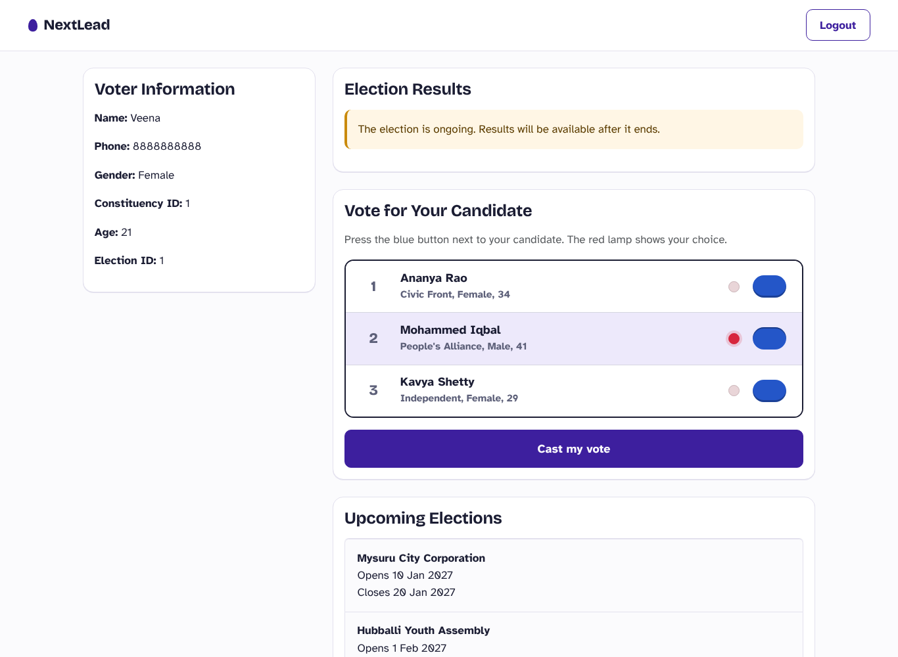

# NextLead

**Online constituency elections: register, vote once, see the count when polls close.**

### 👉 [Open the live app: https://nextlead-cyjp.onrender.com](https://nextlead-cyjp.onrender.com)

## What it does

- **Voters** register with their phone number, constituency and election ID, then cast one vote per election on a ballot laid out like an EVM: numbered candidates, a blue button for each, and a red lamp that lights up on your choice.
- **Candidates** see their profile and the live tally for their constituency.
- **Admins** create elections, manage voters, candidates and constituencies, and publish results.
- A confirmation email is sent after each vote, and forgotten passwords can be reset by email.

## Built with

PHP 8 · MySQL (TiDB Cloud) · Bootstrap 5 · PHPMailer · Docker · Render

## Try it

1. Open the [live app](https://nextlead-cyjp.onrender.com) and click **Register to vote**.
2. Pick **Voter**, and use an election ID shown on the **Elections** page.
3. Log in with your phone number and press the blue button next to a candidate.

> The free server sleeps when idle, so the first visit can take about 30 seconds to load.

## Run it locally

1. Install [MAMP](https://www.mamp.info/) (or any PHP 8 + MySQL setup) and create a database called `voting_system`.
2. Clone this repo into your web folder and run `composer install` to get PHPMailer.
3. Open `http://localhost/nextlead/`. The tables are created automatically on first load.

With no environment variables set, the app uses `localhost / root / root / voting_system`.

## Deploying your own copy

The repo deploys to [Render](https://render.com) from `render.yaml` and the `Dockerfile`; every push to `main` redeploys.
Set these environment variables on Render:

| Variable | Value |
|---|---|
| `DB_HOST`, `DB_PORT`, `DB_NAME`, `DB_USER`, `DB_PASS` | from your MySQL host (TiDB Cloud Starter is free; port `4000`, database `test`) |
| `DB_SSL` | `true` |
| `SMTP_USER`, `SMTP_PASS` | a Gmail address and a Gmail app password |

Never commit passwords to the code; keep them in these environment variables.

---

Made by [Veena SB](https://github.com/veenashanmukh) in Bengaluru.
