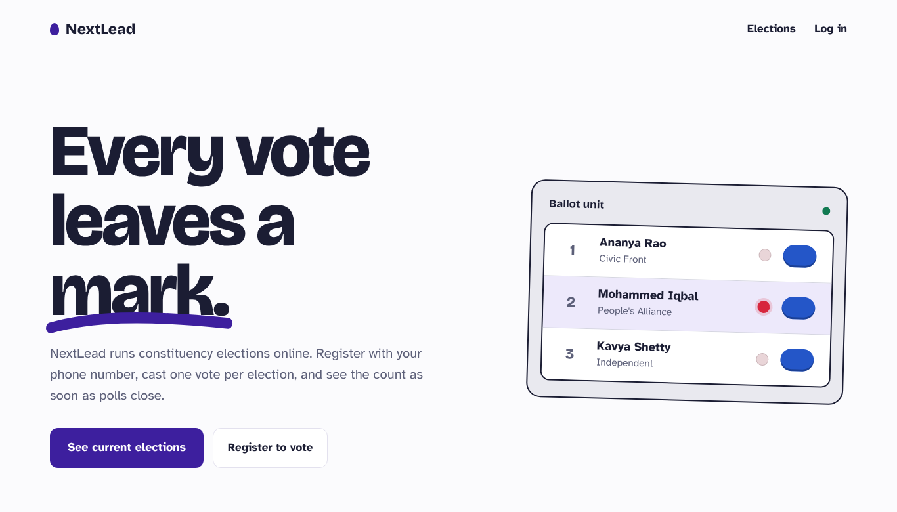
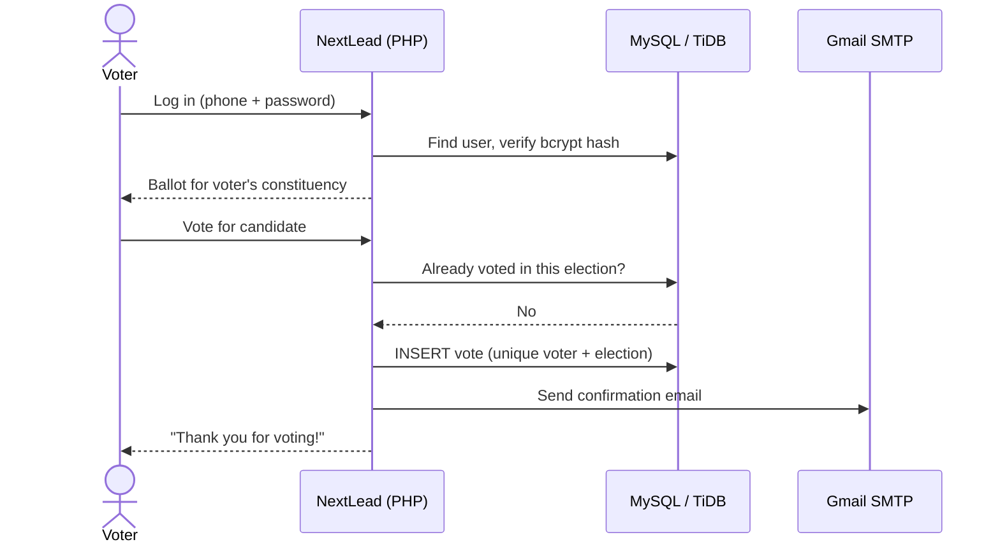
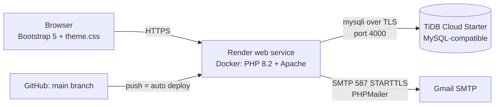
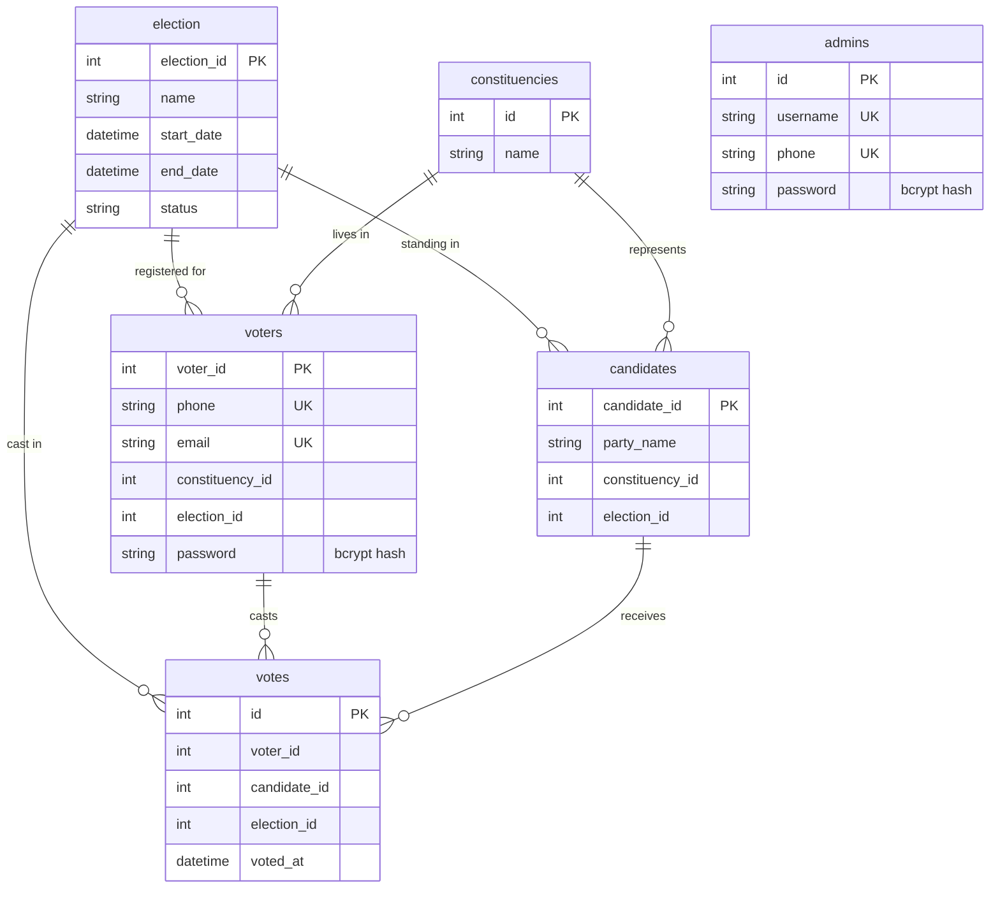

# NextLead

**An online voting system for constituency elections: voters register, vote once on an EVM-style ballot, and the votes are counted instantly.**

### 👉 [Open the live app: https://nextlead-cyjp.onrender.com](https://nextlead-cyjp.onrender.com)

> Hosted on Render's free plan, so the first visit after a quiet spell can take about 30 seconds to wake up.



## The problem

Small elections, like college student councils, housing societies, clubs, and ward or youth committees, are still mostly run on paper or in person. That causes the same problems every time:

- **Voters have to be physically present**, so turnout is low.
- **Counting is manual and slow**, which takes hours and invites mistakes and disputes.
- **Stopping double voting depends on a paper register** and the people checking it.
- **Organisers juggle spreadsheets** for voters, candidates and constituencies, and results are announced late.

## Our solution

**NextLead** is a web application that runs the whole election online, modelled on how Indian elections work:

- **Constituencies.** Each voter sees only the candidates standing in their own constituency.
- **EVM-style ballot.** Numbered candidate rows with a blue button and a red lamp that lights on your choice, so it feels familiar.
- **One person, one vote.** Enforced twice: by the application, and by a unique key in the database.
- **Instant counting.** Votes are tallied by the database the moment they're cast. Admins and candidates see a live tally; voters see the result once the election closes.
- **Three roles**, each with its own dashboard: **Admin**, **Candidate** and **Voter**.
- **Email confirmation** after voting, and password reset by email.

## How an election runs

1. **The admin sets it up.** They create constituencies and an election with a start and end date.
2. **People register.** Voters and candidates sign up with their phone number, email, constituency and election ID. Candidates also give their party.
3. **Polling opens.** A voter logs in with their phone number and password and sees a ballot listing only their constituency's candidates.
4. **The voter presses the blue button** next to a candidate, then **Cast my vote**.
5. **The vote is recorded.** The server checks they haven't voted in this election, saves the vote, and emails a confirmation.
6. **Counting is live.** The admin's results page and the candidate's dashboard show the count as it grows.
7. **Polling closes.** After the end date, voters see the results on their dashboard.



## Features by role

| Role | Can do |
|---|---|
| **Voter** | Register with phone number, constituency and election ID. Log in, vote once per election on an EVM-style ballot, get a confirmation email, and see results after the election closes. |
| **Candidate** | Register with a party name and see their profile and the live tally for their election. |
| **Admin** | Create elections (Upcoming / Ongoing / Completed), manage voters, candidates and constituencies, and view results. |
| **Everyone** | Browse current and upcoming elections, and reset a forgotten password by email. |


## Architecture



It's a classic **server-rendered PHP app**: every page is a PHP file that checks the session, queries MySQL and returns HTML. No front-end framework or build step is needed.

## Tech stack

| Layer | Technology | Details |
|---|---|---|
| Language | **PHP 8.2** | Server-rendered pages, `mysqli` extension |
| Web server | **Apache 2.4** | Official `php:8.2-apache` Docker image |
| Database | **MySQL** (TiDB Cloud Starter in production, MAMP/MySQL locally) | 6 tables, created automatically on first run from `database.sql` |
| Email | **PHPMailer 6** via **Composer** | Gmail SMTP, port 587, STARTTLS, Gmail app password |
| UI | **Bootstrap 5.3**, Bootstrap Icons, custom `theme.css` | Bricolage Grotesque + Atkinson Hyperlegible fonts, "indelible ink" violet theme |
| Hosting | **Render** (Docker runtime, free plan) | Blueprint in `render.yaml`, auto-deploys on push to `main` |
| Container | **Docker** | `Dockerfile` installs `mysqli`, runs `composer install`, binds Apache to Render's `$PORT` |
| Config | Environment variables | `DB_*`, `SMTP_*` and `APP_URL`, no secrets in the code |

## Database schema



`votes` has a **unique key on `(voter_id, election_id)`**, so the database itself refuses a second vote even if two requests race each other.

## How the key parts work (technical)

- **Login and roles.** One login form looks up the phone number in `admins`, `voters` and `candidates`, verifies the password with `password_verify()`, and stores the role in the PHP **session**. Every admin, voter and candidate page checks that role before rendering and redirects to the login page otherwise. `logout.php` destroys the session.
- **Passwords.** Stored as **bcrypt hashes** (`password_hash()`), never in plain text.
- **SQL safety.** Every query that uses form input runs through **prepared statements** (`$conn->prepare()` + `bind_param`), which prevents SQL injection.
- **One vote per election.** `vote.php` checks for an existing vote first, and the unique key backs it up at the database level.
- **Ballot.** Candidates from the voter's constituency are shown as numbered rows with a blue button. Picking one lights a red "lamp", like a real EVM, built with radio inputs and CSS `:has()`.
- **Results.** `results.php` (admin) and the candidate dashboard count votes with `LEFT JOIN` + `COUNT()` + `GROUP BY` per candidate, so candidates with zero votes still appear. Voters see the result only after the election's end date.
- **Emails.** PHPMailer sends a vote confirmation and password-reset links through Gmail SMTP. Reset links carry a random 32-character token (`bin2hex(random_bytes(16))`) and point to the site address in `APP_URL`.
- **Zero-setup database.** On first connection, `connection.php` checks for the tables and runs `database.sql` if they're missing.
- **Cloud-ready config.** `connection.php` reads `DB_HOST`, `DB_PORT`, `DB_NAME`, `DB_USER`, `DB_PASS` and `DB_SSL`, trims stray spaces, and connects with TLS when `DB_SSL=true`. With no variables set, it falls back to local MAMP defaults.

## Run it locally

1. Install [MAMP](https://www.mamp.info/) (or XAMPP, or any PHP 8 + MySQL setup) and create a database called `voting_system`.
2. Clone this repo into your web folder (`htdocs`) and run `composer install` to get PHPMailer.
3. Open `http://localhost/nextlead/`. The tables are created on first load.

With no environment variables, the app uses `localhost / root / root / voting_system`. To send email locally, set `SMTP_USER` and `SMTP_PASS`.

## Deploy your own copy

1. Create a free MySQL-compatible database on [TiDB Cloud](https://tidbcloud.com) (Starter).
2. On [Render](https://render.com): **New → Blueprint**, then pick this repo. It reads `render.yaml` and builds the `Dockerfile`.
3. Set the environment variables:

| Variable | Value |
|---|---|
| `DB_HOST`, `DB_PORT`, `DB_USER`, `DB_PASS` | From TiDB's **Connect** dialog (port `4000`, user looks like `xxxx.root`) |
| `DB_NAME` | `test` |
| `DB_SSL` | `true` |
| `SMTP_USER` | Your Gmail address |
| `SMTP_PASS` | A Gmail **app password** |
| `APP_URL` | Your site's address, used in password-reset links (for example `https://nextlead-cyjp.onrender.com`) |

Every push to `main` redeploys automatically.

## Project structure

```
nextlead/
├── index.php              # Landing page
├── welcome.php            # Current and upcoming elections
├── register.php           # Voter / candidate sign-up
├── login.php, logout.php  # Session login for all roles
├── voter.php, vote.php    # EVM-style ballot, vote + confirmation email
├── candidate.php          # Candidate dashboard and tally
├── admin*.php             # Admin sign-up, login, dashboard
├── create_election.php, manage_*.php, constituency.php
├── results.php            # Vote counts per candidate
├── forgot_password.php, reset_password.php
├── connection.php         # DB connection, env config, auto-create tables
├── database.sql           # Schema
├── theme.css, style.css   # Styles
├── Dockerfile, render.yaml, composer.json
└── docs/                  # Screenshots
```

## Security measures

| Risk | How NextLead handles it |
|---|---|
| Stolen passwords | Stored only as bcrypt hashes (`password_hash` / `password_verify`) |
| SQL injection | Prepared statements with bound parameters for all user input |
| Voting twice | Checked in `vote.php`, and blocked by a unique `(voter_id, election_id)` key |
| Opening pages without logging in | Every dashboard checks the role in the PHP session and redirects to login |
| Leaked credentials | Database and email passwords live in environment variables, never in the repo |
| Fake reset links | Reset links use the fixed `APP_URL`, not the request's `Host` header |

## Known limitations

- The password-reset token lives in the PHP session, so the link must be opened in the same browser that requested it.
- The free Render plan sleeps when idle.

---

Made by **[Veena Shanmukh](https://github.com/veenashanmukh)** in Bengaluru.
